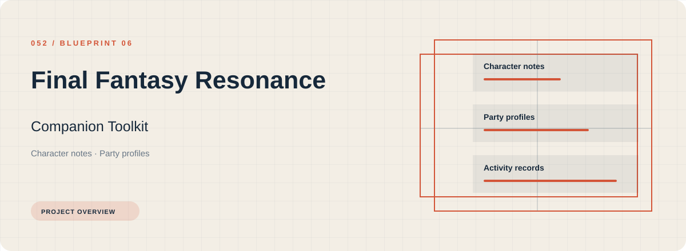
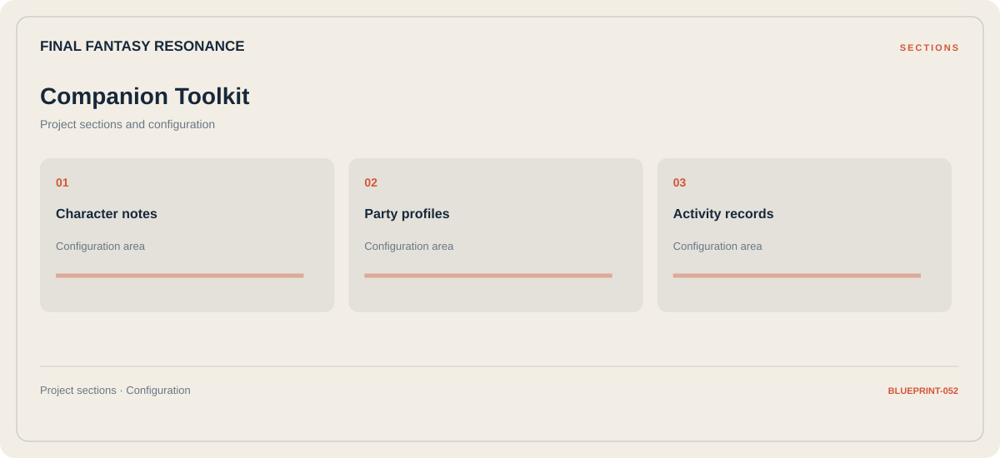

# 🛠️ Final Fantasy Resonance Companion Toolkit

**Character notes · Party profiles · Activity records**

## ⚡ Features

Use the Final Fantasy Resonance companion toolkit workspace to move between character notes, party profiles, and activity records. The section map below gives each part a clear place in the project.

### ⚙️ Character notes

Character-related parameters and the settings associated with the selected category.

### 🧩 Party profiles

Related settings collected into named groups for a clearer configuration workflow.

### ⌨️ Activity records

Session and activity information grouped by the task or context it belongs to.

## 🖥️ Project navigation

## 📥 Download

The button and cover open the project's download page. Use the information supplied with the downloaded package for installation and release-specific requirements.

## 📚 Project documentation

- [Feature reference](docs/FEATURES.md)
- [Download information](docs/DOWNLOAD.md)
- [Project page](index.html)

---

Final Fantasy Resonance Companion Toolkit · Program documentation and download information.
